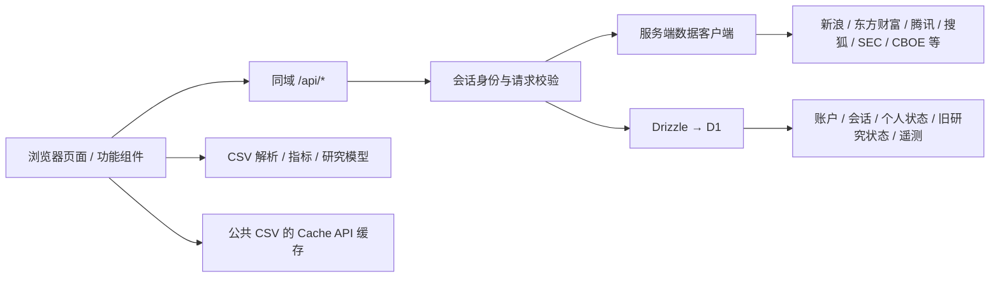

# 技术架构与数据流

本页解释运行边界与数据流。查找具体功能先用 [代码地图](code-map.md)，理解研究口径用 [功能研究地图](feature-research-map.md)，接任务先读 [AI 上下文入口](ai/README.md)。路径和符号以源码为准。

## 运行时与入口

TrendSight 的应用代码都在 `web/`。页面使用 Next.js App Router 约定与 React；实际开发、构建、预览命令调用 **vinext**，由 Vite 与 Cloudflare 插件生成 Worker 产物，并非直接运行 `next dev` / `next build`。

| 层 | 入口 | 职责 |
| --- | --- | --- |
| 工具链 | [package.json](../web/package.json)、[vite.config.ts](../web/vite.config.ts) | Node.js 22.13+、pnpm 10；React、vinext、Cloudflare Vite 插件 |
| HTTP 入口 | [worker/index.ts](../web/worker/index.ts) | `/_vinext/image` 图片优化；其他请求交给 vinext App Router handler |
| 路由保护 | [middleware.ts](../web/middleware.ts)、[accessPolicy.ts](../web/app/lib/accessPolicy.ts) | API / 页面访问策略、数据库会话校验、受保护写请求的同源检查 |
| 全局 UI | [layout.tsx](../web/app/layout.tsx) | `AuthProvider` → `AppearanceProvider` → 页面；主题初始化及全局样式 |
| 页面与功能 | [app/page.tsx](../web/app/page.tsx)、[app/features](../web/app/features)、[app/components](../web/app/components) | 页面编排、功能状态、共享界面；根页面同时承载组合首页与个股工作台 |
| 服务端接口 | [app/api](../web/app/api) | 请求校验、上游适配、账户持久化；每个 `route.ts` 是接口入口 |
| 领域与适配 | [app/lib](../web/app/lib) | 既有纯解析/计算，也有外部客户端和浏览器状态模块；不能把整个目录视为同一运行环境 |
| 数据库 | [db/index.ts](../web/db/index.ts)、[db/schema.ts](../web/db/schema.ts)、[db/accountSchema.ts](../web/db/accountSchema.ts) | `cloudflare:workers` 的 `env.DB` → Drizzle/D1；个人数据表单独定义于 `accountSchema.ts` |

应用数据请求通过同域 API；外部行情协议、请求头与解析集中在客户端模块。用户点击新闻原文等外链不属于这条数据获取链路。

## 页面到数据的主要链路

### 个股研究

1. [app/page.tsx](../web/app/page.tsx) 的 `resolveStockQuery` 识别名称/代码，`security.ts` 规范化市场身份。
2. `fetchStockData` 为该市场选择端点，并行加载历史行情 CSV、新闻 CSV、基本面 JSON；各区域独立完成或报错。
3. `parseMarketCsv` → `aggregateCandles` → 指标/研究模型 → 图表与研究组件；新闻通过 `parseNewsCsv` 进入新闻领域模型。
4. 实时报价独立轮询；[realtimeDailyCandle.ts](../web/app/lib/realtimeDailyCandle.ts)、[closedMarketDay.ts](../web/app/lib/closedMarketDay.ts) 处理实时日 K 合并和完整交易日边界。
5. 切换标的时使用 `AbortController` 与请求版本判断，避免旧响应覆盖新标的；模型与面板也有各自的生命周期保护。

相关契约：`market.ts` 的 `TickRow` / `Candle` / `ParsedDataset`，`news.ts` 的 `ParsedNewsDataset`，`financials.ts` 的 `FinancialDataset`，`realtimeMarket.ts` 的 `RealtimeSnapshot`。字段含义见 [数据格式](data-formats.md)，上游限制见 [数据来源](data-sources.md)。

### 选股、全球市场与个人工作区

- [screener/page.tsx](../web/app/screener/page.tsx) → `GET /api/screener?market=CN|US` → `screenerData.ts`；聚合行情、日 K、指数与研究评分，服务端维护短时缓存和并发合并。跨层契约是 [screenerTypes.ts](../web/app/lib/screenerTypes.ts) 的 `ScreenerFeed`。
- [global-markets/page.tsx](../web/app/global-markets/page.tsx) → `GET /api/global-indexes` → `globalIndexes.ts` / `usMarketIndexes.ts`；响应契约是 `GlobalIndexFeed`。
- 组合、自选、持仓、复盘和偏好 → `accountStorage` 内存门面 → `/api/account-data` → D1；复盘领域模型和导入校验在 `tradingJournal.ts`。复盘具体流转见 [交易复盘](trading-review.md)。

## API 导航

下表列出支持的业务方法；股票接口的 `GET` 通常只返回 405。认证访问以 `accessPolicy.ts` 为准，不能仅凭路由是否直接调用鉴权函数判断它是否公开。

| 路由与方法 | 主要源码 / 数据契约 | 会话 |
| --- | --- | --- |
| `POST /api/local-stock-lookup`、`/api/us-stock-lookup` | `stockLookup.ts` / `usStockLookup.ts`；代码与名称 JSON | 访客可用 |
| `POST /api/local-stock-data`、`/api/us-stock-data` | `remoteMarket.ts` / `usStockMarket.ts`；行情 CSV → `market.ts` | 访客可用 |
| `POST /api/local-stock-news`、`/api/us-stock-news` | `remoteNews.ts` / `usStockNews.ts`；新闻 CSV → `news.ts` | 访客可用 |
| `POST /api/local-stock-financials`、`/api/us-stock-financials` | `financials.ts` / `usStockFinancials.ts`；`FinancialDataset` | 访客可用 |
| `POST /api/realtime-market`、`/api/us-stock-realtime` | `realtimeMarket.ts` / `usStockRealtime.ts`；`RealtimeSnapshot` | 访客可用 |
| `POST /api/local-stock-trades` | `dailyTrades.ts`；当日 Level-1 成交明细 CSV | 访客可用 |
| `GET /api/screener`、`/api/global-indexes` | `screenerData.ts` / `globalIndexes.ts`；聚合 JSON | 必须登录 |
| `GET /api/auth/me`；`POST /api/auth/register`、`login`、`logout`、`password`；`PATCH /api/auth/profile` | [auth 路由](../web/app/api/auth)、`authServer.ts`、`authClient.ts` | 中间件放行；各 handler 执行自己的身份与输入检查 |
| `GET/PUT /api/account-data` | `accountData.ts` 的键白名单、`AccountDataEntry` / `AccountDataWrite` | 必须登录 |
| `GET/PUT /api/research-state` | 旧研究状态兼容接口，`route.ts` 内 `sanitizeState` / `sanitizeStoredState` | 必须登录 |
| `POST /api/telemetry` | `telemetry.ts`、路由内事件白名单；每日次数和耗时汇总 | 必须登录 |

新增或调整接口时，一起检查路由校验、客户端调用、领域类型、解析器和 [api-route-contracts.test.mjs](../web/tests/api-route-contracts.test.mjs)，不要只改响应样例。

## 账户隔离与持久化

当前身份链路是 `authServer.getAuthenticatedUser` → `serverIdentity.resolveUserKey`；身份来自数据库会话，不采信外部邮箱头或 `local-preview`。登录/注册、资料与密码逻辑集中在 [authServer.ts](../web/app/lib/authServer.ts)。

| 表 | 定义 | 语义 |
| --- | --- | --- |
| `users`、`auth_sessions`、`auth_rate_limits` | `db/schema.ts` | 用户资料、加盐密码哈希、会话令牌哈希及过期时间、认证限流 |
| `account_data` | `db/accountSchema.ts` | `(user_key, key)` 复合主键，存储个人工作区与偏好；键白名单在 `accountData.ts` |
| `research_states` | `db/schema.ts` | 旧版研究接口保留；读写均使用真实会话，清理旧持仓载荷，不能作为新的持仓持久化入口 |
| `telemetry_daily` | `db/schema.ts` | 白名单事件的按日汇总，不保存股票查询或研究正文 |

[AuthProvider.tsx](../web/app/components/AuthProvider.tsx) 先确认会话，再 `hydrateAccountStorage(user.id)`，完成后才挂载工作区。账户切换、会话失效时清空内存，并通过账户 key 重新挂载子树；尚未保存的编辑可在内存中保留为原账户的临时备份。

[accountStorage.ts](../web/app/lib/accountStorage.ts) 虽暴露 `getItem/setItem/removeItem`，实际是**内存 + 账户 API**，不是 Local Storage。`PUT` 必须匹配会话用户、数据键和 `revision`；`mutationId` 支持丢失响应后的幂等重试，冲突返回 409，不静默覆盖新数据。新个人数据键必须同步加入白名单，并检查跨账户、并发和错误恢复。

### 浏览器与服务端缓存

- 个人数据不写共享的 Local Storage；数据库响应使用 `private, no-store` 或 `no-store`。
- [browserCache.ts](../web/app/lib/browserCache.ts) 使用 Cache API 的 `ticklens-research-v2` 保存成功的公共行情/新闻 CSV，默认有效期七天。`fetchStockData.requestCsv` 仅在请求抛出网络异常时回退；HTTP 错误仍报错。财务与账户数据不走该回退。
- 上游客户端的模块级缓存与响应缓存头用于公共行情复用，不是持久数据库，也不保证跨 Worker 实例共享。
- `ticklens.*` 存储键、缓存名与部分响应头是兼容性标识。产品名为 TrendSight，不能仅为统一命名而批量替换它们。

## 构建与迁移边界

`pnpm dev` 先运行 [migrate-local-d1.mjs](../web/scripts/migrate-local-d1.mjs)，通过 [wrangler.local.jsonc](../web/wrangler.local.jsonc) 幂等应用本地 SQL 迁移，再启动服务。本地默认存储根是 `.wrangler/state`，Wrangler 在其下使用 `v3/d1`。

[drizzle.config.ts](../web/drizzle.config.ts) 从 `db/*.ts` 生成 SQLite/D1 迁移。`pnpm build` 只构建和打包；[sites-vite-plugin.ts](../web/plugins/sites-vite-plugin.ts) 将 `.openai/hosting.json` 和 `drizzle/` 复制到 `dist/.openai/`，不会替代目标 D1 的迁移应用，也不会自动发布。独立部署须使用自己的托管项目和数据库。

## 修改时必须保留的边界

- A 股与美股使用各自端点和适配模块；`security.ts` 统一身份，美股持久键使用 `US:` 前缀。原币金额按 CNY / USD 分开统计；组合首页另按显式、可编辑的 USD/CNY 汇率展示人民币合计，不改写原币数据。
- CSV 日 K 代理记录、Level-1 明细、财务报告和实时快照含义不同；修改计算前先读 [领域约束](ai/domain-invariants.md)。
- `app/page.tsx`、`market.ts`、`screenerData.ts` 是大型编排/领域入口；修改符号前按 `AGENTS.md` 做影响分析，再读取具体调用链。
- UI 样式同时来自全局层和 CSS Modules；静态源码测试不能证明真实布局效果，界面改动还需浏览器验证。
- 每次功能、API、持久化、运行命令或研究口径改动，同步 [相关文档](ai/documentation-maintenance.md) 和 [验证选择](ai/verification.md)，保持上下文可追踪。
